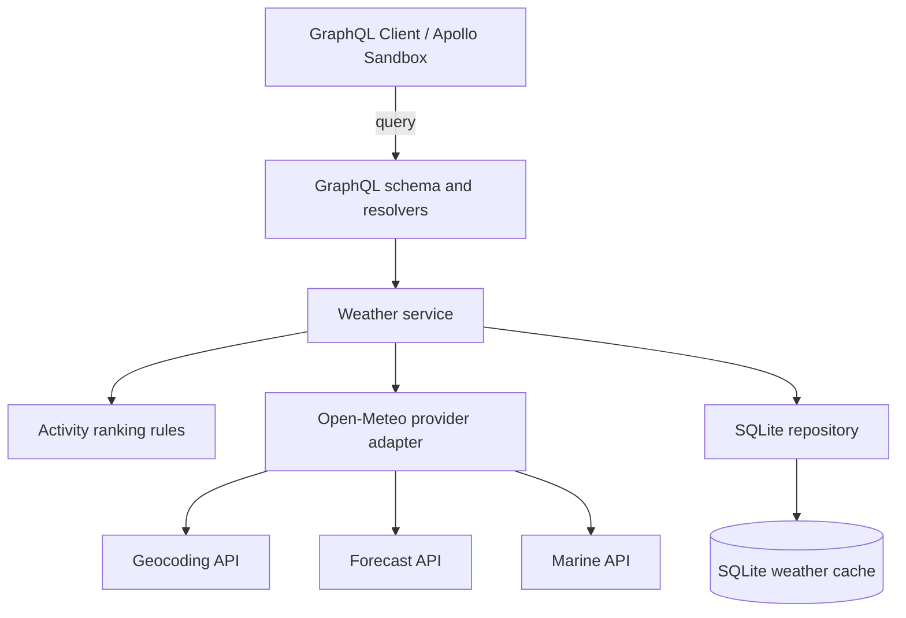

# Weather Activity Suitability Ranking API

A TypeScript GraphQL backend that resolves a city or town, retrieves next-seven-day weather data from Open-Meteo, persists the data in SQLite, and ranks the next seven days for skiing, surfing, outdoor sightseeing, and indoor sightseeing.

## Problem interpretation and assumptions

This service interprets the problem as a weather-based decision-support API rather than a resort booking system or beach-safety system.

Key assumptions:

- The service accepts a city or town name and optionally a country hint to disambiguate locations.
- The ranking window is the next seven daily forecast dates returned by Open-Meteo, with today included when the provider returns it.
- The location timezone is taken from the provider and used for daily date boundaries.
- Surfing is scored only when marine-wave data is available; otherwise the service explicitly reports that the surfing result is unavailable instead of fabricating a score.
- The scoring logic is deterministic and explainable, not machine-learned or scientifically validated.
- Forecasts are cached for six hours by default and may be served for a limited stale window when refreshes fail.

## Architecture diagram



## Source layout

```text
src/
|-- common/
|   |-- interfaces/
|   |   |-- activity.types.ts
|   |   |-- location.interface.ts
|   |   |-- logger.interface.ts
|   |   |-- request.log.interface.ts
|   |   |-- weather.provider.interface.ts
|   |   `-- weather.interface.ts
|   |-- error-handler/
|   |   |-- interfaces/
|   |   |   `-- app.error.types.ts
|   |   |-- tests/
|   |   |   `-- app.error.test.ts
|   |   `-- error.handler.ts       # Shared application errors
|   |-- logging/                   # Shared logger
|   `-- utilities.ts               # Shared numeric conversion and clamp helpers
|-- config/                        # Environment parsing and defaults
|-- database/
|   |-- client.ts                  # Opens SQLite and applies the schema
|   |-- models/
|   |   |-- interfaces/
|   |   |   `-- weather.records.interface.ts
|   |   `-- weather.repository.ts
|   `-- query/
|       |-- schema.sql             # SQLite table definitions
|       |-- weather.repository.sql # Named repository statements
|       `-- index.ts               # Loads named SQL statements
|-- graphql/
|   |-- modules/
|   |   |-- activity-suitability/ # Activity suitability SDL and resolvers
|   |   `-- health/                # Health SDL and resolver
|   |-- shared/                    # Shared GraphQL SDL
|   |-- index.ts                   # Combines SDL and resolvers
|   `-- schema.ts                  # Builds the executable GraphQL schema
|-- middleware/
|   |-- interfaces/
|   |   `-- request.context.interface.ts
|   |-- tests/
|   |   `-- request.logging.test.ts
|   `-- request.logging.middleware.ts
|-- provider/
|   |-- interfaces/
|   |   `-- open.meteo.response.interface.ts
|   `-- open.meteo.provider.ts     # Open-Meteo integration
|-- services/
|   |-- interfaces/
|   |   `-- weather.service.interface.ts
|   |-- ranking/                   # Activity scoring and ranking rules
|   |   |-- tests/
|   |   |   `-- activity.ranking.helper.service.test.ts
|   |   `-- activity.ranking.helper.service.ts
|   |-- tests/
|   |   `-- weather.service.test.ts
|   `-- weather.service.ts         # Forecast and cache orchestration
`-- server.ts                      # Server entry point
```

Contracts shared across features live in `common/interfaces/`. Feature-specific declarations stay beside the feature that owns them. TypeScript file names use dots to separate words and use `.interface.ts` or `.types.ts` for type declarations.

## Technology choices and rationale

- Node.js 22 or newer, as required by `package.json`; npm is used for dependency management and scripts.
- TypeScript with strict compiler checks.
- Apollo Server and GraphQL for the API and schema.
- SQLite via `better-sqlite3` for local persistence.
- Zod for environment configuration validation.
- Vitest with V8 coverage for unit tests.
- ESLint, Prettier, tsx, and Husky for code quality and local development.

Dependency ranges are declared in `package.json`; `package-lock.json` records the resolved dependency tree. Use `npm ci` for a clean install that follows the lockfile.

## Prerequisites

- Node.js 22+ recommended
- npm 10+
- A working internet connection to Open-Meteo endpoints

## Installation and environment configuration

```bash
npm install
copy .env.example .env
```

### Troubleshooting npm install on Windows

If you need to regenerate the dependency lockfile, close any running app processes and run these commands in PowerShell from the project directory:

```powershell
Remove-Item -LiteralPath .\package-lock.json
npm install
```

This creates a new `package-lock.json` and may update dependency versions. It does not fix native build errors. If `better-sqlite3` fails with a `node-gyp` error saying Visual Studio could not be found, install Visual Studio Build Tools with the **Desktop development with C++** workload, then run `npm install` again. If files under `node_modules` are locked, close the dev server and terminals using the project before reinstalling.

The default environment values are:

- `PORT=4000`
- `DATABASE_PATH=./data/weather-cache.db`
- `CACHE_TTL_SECONDS=21600`
- `STALE_MAX_AGE_SECONDS=86400`
- `REQUEST_TIMEOUT_MS=10000`
- `OPEN_METEO_GEOCODING_URL=https://geocoding-api.open-meteo.com/v1/search`
- `OPEN_METEO_FORECAST_URL=https://api.open-meteo.com/v1/forecast`
- `OPEN_METEO_MARINE_URL=https://marine-api.open-meteo.com/v1/marine`
- `OPEN_METEO_FORECAST_DAYS=7`
- `OPEN_METEO_GEOCODING_COUNT=10`
- `OPEN_METEO_LANGUAGE=en`
- `OPEN_METEO_TIMEZONE=auto`

## Database initialization and persistence

The project creates its SQLite schema automatically on startup by executing `src/database/query/schema.sql`. Named repository statements are stored in `src/database/query/weather.repository.sql` and loaded by `src/database/query/index.ts`. Tables include:

- `locations`
- `forecast_snapshots`
- `daily_forecasts`

Each successful upstream fetch is persisted as a snapshot and read back by date. The last successful snapshot is retained if a refresh fails, so the service can continue serving stale-but-useful data inside the stale window.

## Starting the server

```bash
npm run dev
```

Or run the production build:

```bash
npm run build
npm run start
```

The GraphQL endpoint is served at `http://localhost:4000/graphql`.

Each GraphQL operation writes one JSON log line with the request id, operation, duration, and error codes. `LOG_LEVEL` can be `debug`, `info`, `warn`, or `error`. The same request id is returned in the `x-request-id` response header.

## GraphQL examples

Example query:

```graphql
query ActivitySuitability {
  activitySuitability(location: "Chennai", country: "India") {
    location {
      name
      country
      timezone
    }
    forecast {
      date
      temperatureMax
      precipitationProbabilityMax
      windSpeedMax
    }
    activities {
      activity
      bestDay {
        date
        score
        explanation
      }
      rankedDays {
        date
        score
        explanation
      }
    }
    dataFreshness {
      fetchedAt
      cacheAgeSeconds
      isStale
    }
    warnings
  }
}
```

Health check:

```graphql
query Health {
  health
}
```

The health check is currently a GraphQL query at `/graphql`; there is no separate HTTP health route.

## Activity scoring methodology

The scoring engine is intentionally rule-based and transparent. Each activity uses a small set of measured signals and clamps final scores to the range 0 to 100.

### Skiing

- Rewards cool temperatures and snow forecasts.
- Penalizes warm weather, heavy precipitation, and elevated winds.
- Uses weather-only data and clearly labels this as a proxy, not a resort-operating condition.

### Surfing

- Uses marine wave height and wave period when available.
- Penalizes poor wind and severe weather.
- Returns null scores when marine data is absent instead of inventing wave conditions.

### Outdoor sightseeing

- Rewards comfortable temperatures, low rain risk, and manageable wind.
- Penalizes very high precip probability, heavy rainfall, and severe weather.

### Indoor sightseeing

- Rewards poor outdoor conditions and severe weather in a controlled way.
- Avoids assuming that bad weather is inherently good for indoor plans.

## Open-Meteo integrations and data limitations

The provider uses the real Open-Meteo endpoints:

- Geocoding: `https://geocoding-api.open-meteo.com/v1/search`
- Forecast: `https://api.open-meteo.com/v1/forecast`
- Marine: `https://marine-api.open-meteo.com/v1/marine`

Open-Meteo contract references: [Geocoding API](https://open-meteo.com/en/docs/geocoding-api), [Weather Forecast API](https://open-meteo.com/en/docs), and [Marine Weather API](https://open-meteo.com/en/docs/marine-weather-api). Marine data is requested separately because wave variables are not part of the ordinary forecast endpoint.

The service validates the provider payload and handles malformed or missing responses explicitly. It does not rely on fabricated fallback weather data.

## Cache freshness and refresh behavior

The default cache TTL is six hours. When a forecast becomes stale, the next request attempts a refresh. If the refresh fails but the previous snapshot is still within the stale window, the service returns the last successful snapshot with a warning.

Rules:

- Fresh data is served without an upstream request.
- Resolved locations are reused from SQLite by city name and optional country, avoiding repeat geocoding for known names.
- Stale data triggers refresh.
- Refresh failure retains the last good snapshot for a bounded stale period.
- No usable snapshot and refresh failure results in a controlled service error.

## Error handling and resilience

- Invalid blank location names are rejected.
- Ambiguous city names require a country hint. When the provider still returns partial names in that country, an exact city-name match is used.
- Upstream request timeouts and HTTP failures are surfaced as controlled provider errors.
- GraphQL errors return a public message and one of these codes: `INVALID_INPUT`, `LOCATION_NOT_FOUND`, `LOCATION_AMBIGUOUS`, `INVALID_QUERY`, `INVALID_REQUEST`, `WEATHER_UNAVAILABLE`, `INTERNAL_ERROR`. Stack traces and provider error text are not returned. Requests must use `Content-Type: application/json`.
- Concurrent refreshes for the same location are coalesced within the running process.
- Database writes use SQLite transactions and unique constraints to prevent duplicate snapshots.

## Testing and quality checks

The project provides these commands:

```bash
npm run lint
npm test
npm run build
npm run typecheck
npm run format:check
```

Vitest discovers test files under `src/**/tests/**/*.test.ts`. `npm test` runs the unit tests and generates V8 coverage reports in text and LCOV formats.

Before each commit, Husky runs `lint-staged` and then the unit test suite. Both must pass for the commit to proceed. The `prepare-commit-msg` hook prompts for a Conventional Commit message using Commitizen; canceling the prompt stops the commit. You can start the prompt directly with `npm run commit`.

Automated coverage includes:

- Activity scoring thresholds and tie-breaking
- Missing weather data handling
- Fresh-cache reuse
- Stale-cache recovery after provider failure

## Known limitations and future improvements

- The service does not provide user auth or any frontend.
- It does not claim resort or beach safety status beyond the weather data itself.
- The scoring logic remains a transparent heuristic rather than a calibrated product model.
- A future production system could tune weights using historical user feedback and measured outcomes.

## Engineering decisions and trade-offs

- SQLite was chosen over PostgreSQL to keep the project simple, reproducible, and review-friendly.
- A modular monolith keeps the architecture explainable within a single backend service.
- Rule-based scoring intentionally prioritizes transparency over algorithmic sophistication.
- Surfing depends on marine data availability and clearly reports unavailable conditions rather than inventing them.

## GitHub submission notes

This repository is prepared for local publication to a public GitHub repository. No remote repository was created or published without explicit authorization.

To publish later:

```bash
# First create an empty public repository on GitHub, then add its URL:
git remote add origin https://github.com/<owner>/<repository>.git
git push -u origin master
```
